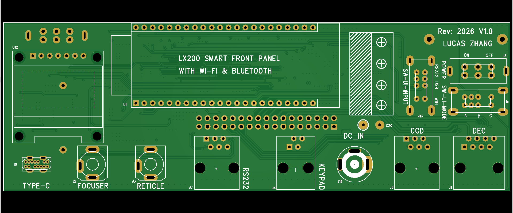
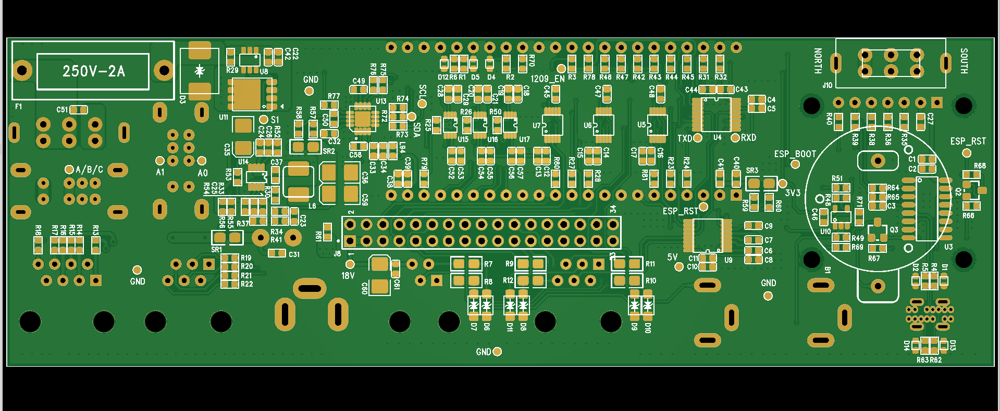

# LX200 Smart Front Panel

**An ESP32-S3-based front-panel retrofit for a legacy LX200 telescope-control system**

This project redesigns a telescope front panel to add modern wired and wireless connectivity while retaining the original control pathway. The design combines a hardware-switched serial-routing matrix with FreeRTOS firmware, allowing the user to choose between direct hardware passthrough and an alternate keypad-translation control path.

> **Project status:** This README documents the product requirements, proposed hardware architecture, firmware requirements, and planned validation. A requirement or planned test described here should not be read as proof that the feature is implemented or has passed testing. Add measured results as they become available.

## At a Glance

- **Controller:** Removable ESP32-S3 development board
- **Operating system:** FreeRTOS
- **Serial rate:** 9600 baud for the telescope-control routing paths
- **Input interfaces:** RS-232, USB-C serial, and Wi-Fi/Bluetooth
- **Control paths:** Mode A hardware passthrough and Mode B keypad translation
- **Local interface:** OLED status and power telemetry display
- **Power input:** External 18 V, converted locally to a regulated 5 V rail
- **Hardware design files:** [Schematic source](hardware/schematic/) · [PCB source](hardware/pcb/)
- **Firmware:** [Source files](firmware/src/) · [Headers and configuration](firmware/include/)

## Project Goals

The original front panel is centered on the telescope's existing wired serial interface and physical hand controller. This retrofit is designed to add USB-C and wireless host connectivity without replacing the original motherboard or making normal operation depend on the ESP32.

The principal goals are to:

1. Retain a hardware-level passthrough path for the original serial-control behavior.
2. Add USB-C serial and Wi-Fi/Bluetooth as selectable host inputs.
3. Provide a fallback path that interprets external host commands and translates them into physical-handset-style keypad actions.
4. Give manual hand-controller input priority over automated commands.
5. Show connection state, operating mode, voltage, current, and relevant diagnostic information on a local OLED.
6. Use defined startup, switching, and fault-handling behavior to help prevent unintended commands from reaching the telescope motherboard.

## Two Independent Selectors: A/B and 0/1/2

The device has **two separate physical controls**. They answer different questions and should not be confused with each other.

### Control-path selector: Mode A or Mode B

The `SW-UI-MODE` switch determines whether the external host is routed through the original hardware path or through the ESP32's keypad-translation path.

- **Mode A — Hardware Passthrough:** The selected host path is routed through the hardware switching network toward the original telescope-control interface. The ESP32 is bypassed from the primary host-control path for the RS-232 and USB-C selections. When Wi-Fi/Bluetooth is selected, the ESP32 supplies the serial data through UART2. The original hand controller retains its direct hardware path.
- **Mode B — Keypad Translation:** The hardware routing matrix directs the host input to the ESP32. Firmware interprets supported external commands and translates them into keypad command sequences sent to the motherboard. The hand controller remains connected and its activity has priority over automated injection.

### Input-source selector: Position 0, 1, or 2

The `SW-UI-INPUT` switch selects which external host source is active.

| Selector position | Source | Intended connection |
|---|---|---|
| **0** | RS-232 | Original wired serial interface, through RS-232/TTL conversion as required |
| **1** | USB-C | USB-to-serial interface, using CH340C or CP2102 as specified |
| **2** | Wi-Fi/Bluetooth | ESP32-S3 wireless link, with serial output available through UART2 in Mode A |

These positions are **input-source positions**, not alternatives to Mode A and Mode B. Combining the two switches produces six operating combinations: **A0, A1, A2, B0, B1, and B2**.

The selector uses a two-bit logic code to distinguish the three positions. The `11` combination is considered an illegal hardware state. Firmware is required to ignore short transients and report an error only if that combination remains stable beyond the switch debounce period.

## Six-State Routing Matrix

| State | Input source | Intended data behavior |
|---|---|---|
| **A0** | RS-232 | Direct hardware passthrough. The selected serial stream follows the original host-control path without ESP32 command translation. |
| **A1** | USB-C | Direct hardware passthrough through the USB-to-serial interface and switching network. |
| **A2** | Wi-Fi/Bluetooth | The ESP32 receives the wireless host data and outputs the serial stream through UART2 to the Mode A hardware path. |
| **B0** | RS-232 | The host stream is routed to UART2. Firmware parses and translates supported commands, then injects keypad actions through UART1. |
| **B1** | USB-C | The USB serial stream is routed to UART2 and passed to the same command-translation engine used by B0. |
| **B2** | Wi-Fi/Bluetooth | Wireless commands from the ESP32 network stack enter the translation engine directly and are injected through UART1. UART2 is to remain inactive and its loopback receive data must not enter the parser. |

In Mode B, the hand controller communicates through the ESP32 so firmware can observe handset activity and motherboard responses. Physical handset input is always the highest-priority control source. If physical input occurs during an automated sequence, the remaining injection queue should be cancelled and control returned to the handset.

## Hardware Architecture

The design uses a removable ESP32-S3 development board mounted through pin headers, a custom PCB intended to match the original front panel's outline and mounting-hole geometry, and discrete analog switches to implement the signal-routing matrix. The routing is performed in hardware; the firmware reads the switch states and changes its behavior to match the selected topology.

### External interfaces and retained functions

The front-panel design is intended to retain the original main power switch, RS-232 connector, RJ12 hand-controller connector, and designated legacy connections. The new USB-C interface occupies the former J9 AUX location and is specified for data only, without a VBUS connection to the board. The RS-232 interface is also specified as data-only.

The following legacy ports are specified to remain direct 1:1 bypass connections to the original 34-pin ribbon-cable interface:

- **J1 DEC** — motor 1
- **J2 FOCUSER**
- **J3 RETICLE** — illumination
- **J6 CCD** — auto-guider port

J9 AUX is removed and its physical location is repurposed for USB-C. The N/S (North/South) switch is retained and specified to move to the rear of the PCB. The 34-pin dual-row motherboard connector must preserve the original pin definitions, including the designated host serial and keypad signal pins.

### Core hardware subsystems

- **Input switching:** `IC-SW-INPUT` selects among RS-232, USB-C serial, and the ESP32 wireless/UART2 path.
- **Mode switching:** `IC-SW-MODE` selects the direct host path or the ESP32-intercept path.
- **Hand-controller routing:** `IC-SW-K1` and `IC-SW-K2` route the handset and motherboard keypad connection according to Mode A or Mode B.
- **ESP32-S3 module:** Supervisory controller for switch-state monitoring, wireless connectivity, telemetry, and Mode B command translation.
- **RS-232 conversion:** MAX3232 is specified for converting between TTL-level UART signals and RS-232 voltage levels.
- **USB serial:** CH340C or CP2102 is specified for the USB-C-to-serial interface.
- **Logic-level translation:** Dedicated translation is required at ESP32 connections to the 5 V TTL routing logic. TXS0102 is listed as a possible device; TXB0102 is explicitly excluded in the requirements.
- **Motherboard transmit gate:** A 74LVC1G125-class tri-state buffer is specified on the ESP32's motherboard-facing transmit line. Its output should remain disabled during startup and only be enabled after initialization and confirmed Mode B selection.
- **OLED and telemetry:** A local OLED reports state and power readings from an external I²C power-monitoring IC.

### Power and electrical protection requirements

The board is designed for an **18 V external input** and a local **18 V-to-5 V switching buck-regulator stage**. The locally generated 5 V rail must not be routed back into the telescope motherboard. The ESP32 module requires its suitable local power rail and logic-level translation; there is no requirement for a global 3.3 V routing rail.

The product requirements also call for reverse-polarity protection, TVS protection on external interfaces, input bulk and high-frequency filtering, defined pull-up/pull-down states for switching controls, and careful treatment of ground return paths between power and digital sections. The primary 18 V-to-5 V stage must use a buck converter rather than an LDO. The PCB layout is intended to separate high-power and low-voltage logic areas and to account for thermal dissipation and signal integrity.

These are design requirements; electrical safety, voltage ripple, grounding, isolation, and protection performance should be treated as unverified until measured on the assembled hardware.

## Schematic and PCB Views

### Schematic overview

The complete three-page schematic overview is provided as a PDF:

**[Open the schematic overview (PDF)](assets/schematic-overview.pdf)**

GitHub can render a PDF when the link is opened, so you can keep the schematic as one multi-page document instead of exporting and maintaining three separate images. The PDF itself must be uploaded to `assets/schematic-overview.pdf` for this link to work. GitHub does not reliably display a PDF *inline inside the README text*; the link opens GitHub's PDF viewer. If you later want the PDF embedded directly on a GitHub Pages website, that can be done with an HTML page and an `<object>` or `<iframe>` element.

The editable/native schematic project belongs in [`hardware/schematic/`](hardware/schematic/).

### PCB render — view 1



### PCB render — view 2



> Keep the filenames and capitalization aligned with the files uploaded to `assets/`, or update the paths above.

## Firmware Architecture

The firmware is designed for **FreeRTOS** on the ESP32-S3. It uses asynchronous tasks and queues to separate high-priority serial traffic from lower-priority display updates, diagnostics, and configuration work. The three native hardware UARTs are allocated to the handset, motherboard keypad link, and selected external serial path. The native USB-Serial/JTAG controller is reserved for flashing, debugging, and system logs rather than business serial traffic.

All telescope-control UART paths are specified for **9600 baud**. The firmware should initialize with business transmissions disabled, read the physical switch states, initialize serial peripherals and RTOS resources, then enable the motherboard-facing gate only when the relevant Mode B safety conditions are met.

### UART allocation

| Interface | Primary function |
|---|---|
| **UART0** | Hand-controller communication: captures handset activity and forwards relevant motherboard feedback to the physical handset path. |
| **UART1** | Motherboard keypad link: sends translated keypad actions and receives motherboard feedback. Physical handset forwarding has the highest priority when sharing this path. |
| **UART2** | Selected external serial input/output. It is used for RS-232/USB host streams routed through hardware and for the wireless serial path in A2. It must be isolated from receive/parser activity in B2. |
| **Native USB-Serial/JTAG** | Firmware flashing, debugging, and `ESP_LOG` output, independently of the three business UARTs. |

### Firmware modules

The planned modular source layout is under [`firmware/src/`](firmware/src/) with headers and configuration under [`firmware/include/`](firmware/include/).

| Module | Responsibility |
|---|---|
| `main.c` | Application entry, startup pin-state identification, initialization, and FreeRTOS task scheduling. |
| `switch_monitor.c` | Reads both physical switches, debounces transitions, decodes source position, rejects an invalid selector state, and requests routing updates. |
| `failsafe_gate.c` | Controls the motherboard-facing tri-state transmit gate; keeps it disabled until initialization and Mode B confirmation requirements are met. |
| `router_bridge.c` | Coordinates UART forwarding, host input routing, command arbitration, motherboard feedback, and keypad-to-host response forwarding. |
| `transcode_engine.c` | Maps supported ASCII host commands to the corresponding keypad command representations using static lookup tables where appropriate. |
| `virtual_handset.c` | Tracks an estimated handset/UI state, records automated sequence progress, and accounts for interrupted macro sequences. |
| `oled_display.c` | Sole owner of OLED bus access and shared display mutex; exposes thread-safe rendering APIs to other modules. |
| `telemetry_adc.c` | Collects voltage/current readings and requests OLED updates without blocking high-priority serial forwarding. |

### Switch debounce and fault behavior

The firmware requirements specify independent **50 ms debounce** intervals for both physical switches. The routing state, UART reinitialization, tri-state buffer behavior, and OLED labels should only be updated after a new state remains stable for the required interval. Brief transitional combinations are filtered rather than treated as a real selection.

If the two-bit input selector remains at illegal code `11` beyond the debounce interval, firmware should retain the last valid routing state, log the fault, and display an error once on entry to the fault state rather than repeatedly refreshing the screen in a polling loop.

When a confirmed routing change requires UART reinitialization, the requirements call for clearing the affected UART input and output buffers to reduce the chance of stale bytes or an initial garbled character crossing between states. UART2 must not transmit or feed receive data to the command parser in B2.

### Command arbitration and keypad translation

In Mode B, external host commands and physical handset activity share the motherboard keypad path. The arbitration rules are designed to ensure that handset activity cannot be preempted by an automated macro:

1. Physical handset data from UART0 has the highest priority for the UART1 motherboard path.
2. External host commands are parsed and translated through a common command engine, regardless of whether the source is RS-232, USB-C, or wireless.
3. Automated command sequences should start from a known main-screen baseline using the specified reset/navigation sequence, rather than relying exclusively on a state remembered in software.
4. If a physical handset byte arrives during automated injection, the remaining macro queue should be cancelled immediately, injection buffers cleared, and control returned to the physical handset.
5. Motherboard feedback should be forwarded to the physical handset with minimal latency. Display mirroring and logging should be handled asynchronously so they do not block the UART forwarding path.

The firmware requirements also describe a virtual handset/UI state model and Bluetooth/Web-based remote command injection. These features depend on correctly implemented parsing, routing, state tracking, and physical-input preemption.

### OLED and telemetry behavior

The OLED is intended to show a boot message during reset, followed by the currently selected input source and A/B mode, alongside voltage and current readings refreshed at approximately 2 Hz. In Mode B, the display may also mirror the information intended for the original hand controller's two-line display.

All display requests must pass through `oled_display.c`; other modules should not directly operate the I²C bus or create independent OLED mutexes. Screen updates are intended to be split into small chunks and scheduled at lower priority than serial forwarding. I²C timeout, bus recovery, and OLED hardware reset handling are specified for recovery from a hung display bus.

### Wireless and configuration features

The product requirements specify Wi-Fi operation in both Station (client) and Access Point (hotspot) modes, BLE GATT services, and a web server for remote commands. A configuration interface is intended to be accessible through supported USB, Wi-Fi, or Bluetooth paths, with settings persisted in ESP32 non-volatile storage (NVS). Example settings include wireless network configuration and other device parameters.

Wireless command injection is mode-dependent: A2 provides a serial stream through UART2 into the direct hardware path, while B2 routes wireless commands internally through the translation engine and UART1. B2 must not use UART2 as a command loopback path.

## Validation and Acceptance Tests

The PRD and FRD define the following verification areas. They are listed here as **test targets**, not as completed results.

### Routing and communications

- Verify Mode A direct hardware passthrough for RS-232 and USB-C.
- Verify A2 wireless-to-serial forwarding through UART2 and the Mode A routing path.
- Verify B0 and B1 host input is parsed and translated to keypad commands through UART1.
- Verify B2 wireless commands enter the translation engine directly and that UART2 receive data is ignored and UART2 transmission remains inactive.
- Verify bidirectional handset and motherboard communication in Mode B.
- Verify serial operation at the specified 9600 baud rate.

### Priority, timing, and state

- Verify the 50 ms debounce behavior of both switches and check that transitions do not cause routing jitter or OLED flicker.
- Verify that a stable illegal `11` selector code preserves the last valid route and produces one fault notification on entry.
- Verify safe boot behavior and that the motherboard-facing transmit gate is disabled until the required initialization and mode checks are complete.
- Verify physical handset data takes priority over host injection and that a physical key press cancels an active macro sequence within the specified response target.
- Verify the virtual-handset model records the state of a macro interrupted by manual input.
- Verify the handset-idle arbitration rule after its final timeout value is reconciled (see note below).
- Verify buffer flushing and clean reinitialization during stable mode changes.

### OLED, power, and protection

- Verify that asynchronous OLED refresh does not cause serial data loss and that display mirroring does not block UART forwarding.
- Verify display timeout and recovery behavior after an I²C bus fault.
- Measure the local 5 V rail under the intended 18 V input and check the specified ripple target.
- Verify reverse-polarity protection, interface protection, and no back-powering of the motherboard from the local 5 V rail.
- Verify the hardware passthrough path remains functional with the ESP32 isolated from the primary host data path in Mode A.

## Open Requirement to Reconcile

The PRD specifies that automated host commands should wait until the handset has been idle for **500 ms**, while the FRD defines `HANDSET_IDLE_TIMEOUT_MS` as **200 ms**. The FRD also describes a possible short inter-frame insertion behavior for certain handset packet gaps. These timing rules are not identical and should be reconciled before implementation and acceptance testing treat the arbitration timing as finalized.

The FRD also specifies key-hold and key-gap timing for virtual handset sequences. The implementation should use named configuration constants for these values rather than scattered hard-coded delays, then validate them against the actual motherboard and handset behavior.

## Repository Layout

```text
.
├── README.md
├── .gitignore
├── assets/
│   ├── schematic-overview.pdf
│   ├── pcb-render-1.jpg
│   └── pcb-render-2.jpg
├── hardware/
│   ├── schematic/       # Native schematic and related source files
│   └── pcb/             # Native PCB design/source files
└── firmware/
    ├── include/         # Headers and configuration
    └── src/             # Firmware source code
```

## Project Files

- **Schematic overview:** The three-page PDF is linked above as `assets/schematic-overview.pdf`.
- **PCB renders:** Two board render images are shown above in `assets/`.
- **Editable hardware source:** Add the native schematic project to [`hardware/schematic/`](hardware/schematic/) and the native PCB project to [`hardware/pcb/`](hardware/pcb/).
- **Firmware source:** Add the ESP32-S3 application code and its header/configuration files to [`firmware/src/`](firmware/src/) and [`firmware/include/`](firmware/include/).

The native hardware project and source code are the authoritative implementation references. The images are overview visuals and are not substitutes for the editable source files.
